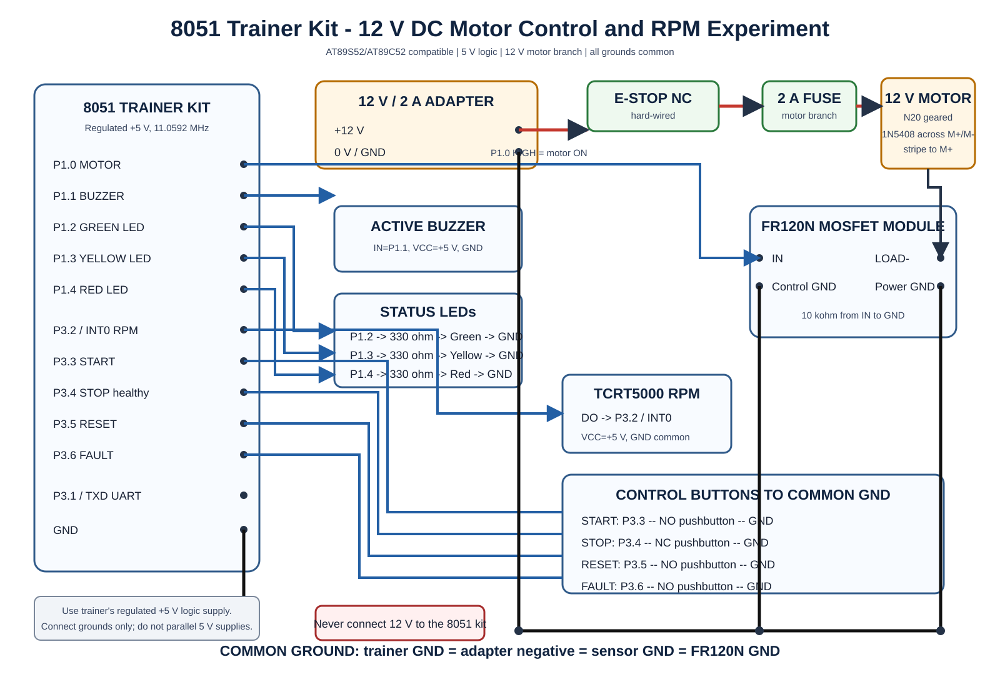

# Experiment: Interfacing a 12 V DC Motor With an 8051 Trainer Kit

## Aim

Interface a low-voltage 12 V geared DC motor with an AT89S52/8051 trainer kit and demonstrate:

- START, STOP and trip RESET control
- Safe motor switching through an FR120N MOSFET module
- TCRT5000 RPM pulse counting
- Green, yellow and red status LEDs
- Buzzer indication and latched fault behavior
- RPM reporting through the trainer's UART

This is a short, supervised first-year experiment. It is intentionally simpler than the main ESP32 monitoring project.

## Trainer-kit assumption

The wiring and Keil C51 program assume:

- AT89S52, AT89C52 or compatible standard 8051 MCU
- 11.0592 MHz crystal (UART works at 9600 baud)
- Regulated +5 V logic supply
- P1, P2 and P3 pins available on headers
- Common ground terminal available
- Keil C51 header `REG51.H`

If your lab kit uses a different MCU, crystal, fixed active-low LEDs or shared port wiring, verify its manual before connection. Never guess pin labels from connector position alone.

## Learning scope

The supplied `src/main.c` directly supports only the simple first-year circuit: buttons, RPM sensor, LEDs, buzzer, simulated fault and motor switching. The full INA219/MPU6050/OLED/DS18B20 expansion is mapped later in this document, but it requires separate sensor-driver experiments.

## Required components

| Component | Quantity | Requirement |
|---|---:|---|
| 8051 trainer kit | 1 | AT89S52/AT89C52-compatible, exposed ports, +5 V |
| 12 V geared DC motor | 1 | N20, approximately 300 RPM, normal current below 1 A |
| FR120N MOSFET module | 1 | 5 V input-compatible, low-side motor switching |
| 12 V isolated adapter | 1 | 12 V, 2 A |
| 2 A fuse and holder | 1 | In series with motor supply |
| Emergency cutoff switch | 1 | Latching NC, in series with 12 V motor branch |
| 1N5408 diode | 1 | Flyback diode across the motor |
| TCRT5000 module | 1 | Digital output module, one reflective mark per revolution |
| START pushbutton | 1 | Normally open, momentary |
| STOP pushbutton | 1 | Normally closed, momentary |
| RESET pushbutton | 1 | Normally open, momentary |
| FAULT pushbutton | 1 | Normally open, momentary; simulates a sensor trip |
| LEDs | 3 | Green, yellow and red |
| LED resistors | 3 | 330 ohm, 1/4 W |
| Active buzzer module | 1 | 5 V logic-compatible; use a transistor driver if bare buzzer current exceeds 10 mA |
| 10 kohm resistor | 1 | Pull-down from FR120N IN to GND |
| 470 uF/25 V capacitor | 1 | Across 12 V near motor driver |
| 100 nF capacitor | 1 | Across motor terminals for noise reduction |

## 8051 pin map used by the code

| 8051 pin | Trainer label | Connection | Direction / active state |
|---|---|---|---|
| P1.0 | Port 1 bit 0 | FR120N control IN | Output, HIGH = motor ON |
| P1.1 | Port 1 bit 1 | Active buzzer input | Output, HIGH = buzzer ON |
| P1.2 | Port 1 bit 2 | Green LED through 330 ohm | Output, HIGH = ON |
| P1.3 | Port 1 bit 3 | Yellow LED through 330 ohm | Output, HIGH = ON |
| P1.4 | Port 1 bit 4 | Red LED through 330 ohm | Output, HIGH = ON |
| P3.2 / INT0 | Port 3 bit 2 | TCRT5000 DO | Falling-edge RPM input |
| P3.3 | Port 3 bit 3 | START NO button to GND | Input, LOW = pressed |
| P3.4 | Port 3 bit 4 | STOP NC contact to GND | Input, LOW = healthy; HIGH = stop/open wire |
| P3.5 | Port 3 bit 5 | RESET NO button to GND | Input, LOW = pressed |
| P3.6 | Port 3 bit 6 | FAULT NO button to GND | Input, LOW = fault |
| P3.0 / RXD | UART RX | Optional USB-UART TX | Leave open if only viewing output |
| P3.1 / TXD | UART TX | Optional USB-UART RX | 5 V TTL only; common GND |

The code sets P3 input bits HIGH so the 8051's internal pull-ups can be used. START, RESET and FAULT therefore need no external pull-up. The STOP contact is intentionally normally closed so a loose/open STOP wire also stops the motor.

## Complete power wiring

### Motor branch

```text
12 V adapter + -> emergency-stop NC -> 2 A fuse -> motor +
motor - -> FR120N LOAD-/switched terminal
FR120N power GND -> 12 V adapter -
```

Connect the 1N5408 directly across the motor: striped cathode to motor positive and anode to motor negative. Connect 100 nF across the motor terminals and 470 uF/25 V across 12 V and GND near the FR120N.

### Logic branch

Use the trainer kit's normal regulated 5 V supply. Connect only its GND to the 12 V adapter negative/FR120N GND. Do not connect 12 V to any trainer pin. Do not power the trainer simultaneously from two different 5 V sources unless its manual explicitly allows it.

### Motor control

```text
8051 P1.0 -> FR120N IN
8051 GND  -> FR120N control GND
10 kohm   -> between FR120N IN and GND
```

The 8051 port must never drive the motor directly.

## Button, LED, buzzer and RPM connections

| Part | Exact connection |
|---|---|
| START NO | One terminal to P3.3; other terminal to GND |
| STOP NC | One terminal to P3.4; other terminal to GND |
| RESET NO | One terminal to P3.5; other terminal to GND |
| FAULT NO | One terminal to P3.6; other terminal to GND |
| TCRT5000 | VCC to +5 V, GND to GND, DO to P3.2/INT0 |
| Green LED | P1.2 -> 330 ohm -> LED anode; LED cathode -> GND |
| Yellow LED | P1.3 -> 330 ohm -> LED anode; LED cathode -> GND |
| Red LED | P1.4 -> 330 ohm -> LED anode; LED cathode -> GND |
| Active buzzer module | IN to P1.1, VCC to +5 V, GND to GND |

Some trainer kits already connect LEDs or a buzzer as active-LOW devices. Use external parts as shown for exact agreement with the code, or invert the output macros in `main.c` after checking the kit schematic.

## Circuit diagram



A 300 dpi PNG version is also provided at `docs/8051_trainer_motor_circuit.png` for insertion into an experiment file.

The complete printable lab sheet is available as [8051 Trainer DC Motor Experiment Guide](docs/8051_Trainer_DC_Motor_Experiment_Guide.pdf).

## Program behavior

1. At power-up the motor is OFF, yellow READY LED is ON and the trip latch is clear.
2. Press START: motor and green LED turn ON if STOP is healthy and no fault is active.
3. Press STOP or open its wire: motor turns OFF, red LED and buzzer turn ON, and the trip is latched.
4. Press FAULT: the same latched trip occurs. This safely demonstrates protection without stalling the motor.
5. Remove the fault/restore STOP and press RESET: trip clears, motor stays OFF and yellow READY returns.
6. Press START separately to run again.
7. The TCRT5000 produces one falling-edge pulse per revolution. The program prints approximate RPM every second at 9600 baud.

## Build and program using Keil uVision

1. Create a new 8051 project and select `Atmel AT89S52` or the trainer's exact MCU.
2. Add `src/main.c` to Source Group 1.
3. In Options for Target, set crystal frequency to 11.0592 MHz.
4. Enable Create HEX File.
5. Build the project and program the HEX using the trainer kit's ISP/programmer software.
6. If available, open the trainer USB-UART terminal at 9600 baud, 8 data bits, no parity, 1 stop bit.

## Observation table

| Test | Expected motor | LED / buzzer result | Trip latch |
|---|---|---|---|
| Power ON | OFF | Yellow ON | Clear |
| START pressed | ON | Green ON | Clear |
| STOP pressed/open | OFF | Red + buzzer ON | Set |
| START after trip | OFF | Red + buzzer remain ON | Set |
| RESET while unsafe | OFF | Red + buzzer remain ON | Set |
| RESET after restoring inputs | OFF | Yellow ON | Clear |
| START after RESET | ON | Green ON | Clear |

## Full sensor expansion on the 8051

The current project's sensors can also be electrically connected to the 8051, but their driver code is intentionally outside the first experiment.

| Device | 8051 connection | Supply | Mandatory interface note |
|---|---|---|---|
| INA219 | SDA through level shifter to P2.0; SCL through level shifter to P2.1 | 3.3 V logic; motor bus at VIN+/VIN- | Address 0x40; high-side current/power measurement |
| MPU6050 | Same P2.0/P2.1 I2C bus through level shifter | 3.3 V | Address 0x68; mount rigidly on motor bracket |
| SSD1306 OLED | Same P2.0/P2.1 I2C bus through level shifter | 3.3 V | Address normally 0x3C |
| DS18B20 | DATA to P1.5 | 5 V | Add 4.7 kohm from DATA to +5 V |
| TCRT5000 | DO to P3.2/INT0 | 5 V | Adjust module threshold for one clean pulse/revolution |

Use a BSS138 bidirectional I2C level-shifter module:

```text
8051 +5 V -> HV             LV <- regulated 3.3 V
8051 P2.0 -> HV1            LV1 -> sensor SDA
8051 P2.1 -> HV2            LV2 -> sensor SCL
Common GND ---------------------- sensor GND
```

Do not connect a 5 V I2C pull-up directly to INA219, MPU6050 or SSD1306 logic pins. The 8051 version also has no Wi-Fi/MQTT dashboard unless an additional communication module is added.

## Precautions

- Keep the experiment low-voltage; never use mains wiring.
- Verify STOP reads LOW before START.
- Keep motor power OFF while rewiring.
- Fix the motor and RPM disc firmly.
- Never block the motor shaft to create a fault; use the FAULT button.
- Verify common ground before enabling the motor.
- If the FR120N input behavior differs, test it first with the motor disconnected.
