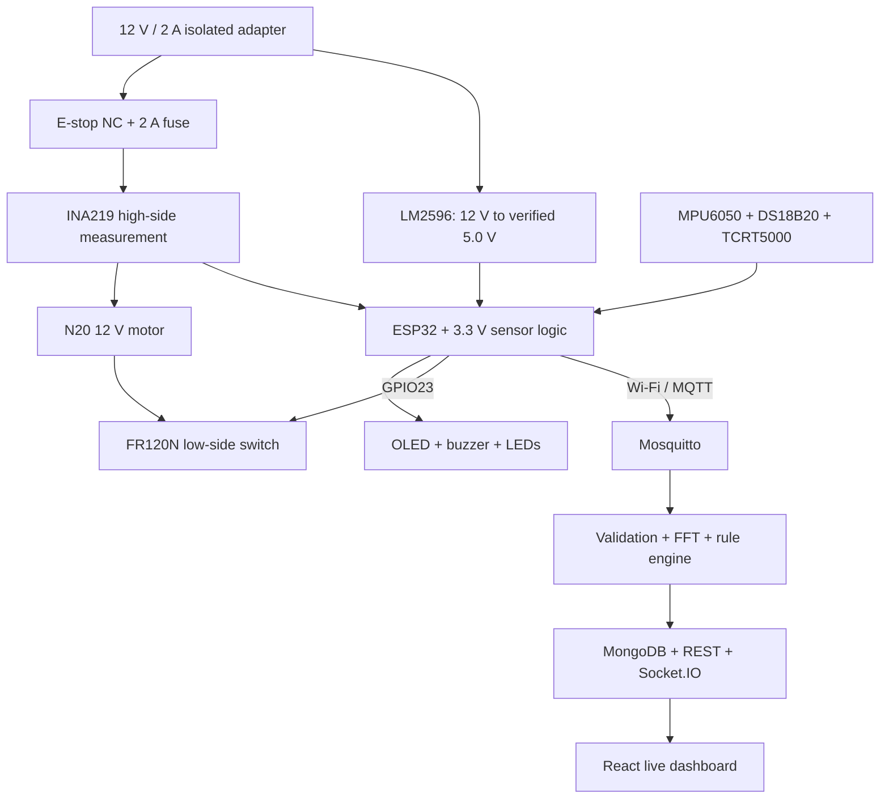
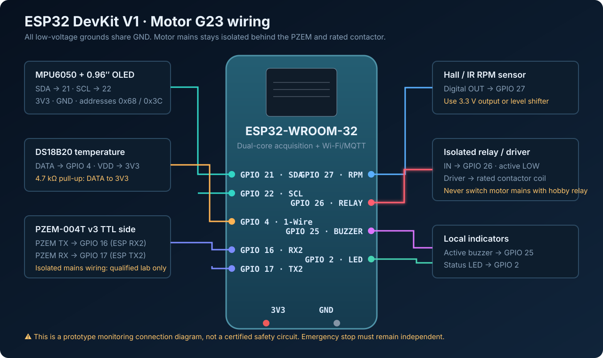

# IoT-Based 12 V DC Motor Condition Monitoring and Automatic Shutdown

[](https://github.com/MayankGangwar1234/motor_monitoring/actions/workflows/ci.yml)

Group 23 final-year ECE demonstration model for monitoring a small **12 V, 300 RPM N20 geared DC motor** with an ESP32. It measures casing temperature, vibration, DC bus voltage/current/power and actual RPM; publishes data through MQTT; performs RMS/FFT analysis; stores history; displays live graphs; and switches the motor OFF through an FR120N MOSFET module when a protected stop or configured fault occurs.

> **Safety:** this is a short, supervised low-voltage educational model. The latching emergency-stop and 2 A fuse are hard-wired in the motor branch and do not depend on software. Fix the motor and wheel firmly, keep hands and loose wires away, disconnect the adapter before rewiring, and never deliberately stall the motor.

## Hardware baseline

- ESP-WROOM-32 development board
- N20 metal gear motor, 12 V, 300 RPM, wheel and mounting bracket
- MPU6050 vibration sensor
- DS18B20 waterproof casing-temperature probe with 4.7 kohm pull-up
- INA219 high-side DC voltage/current/power sensor
- TCRT5000 reflective RPM sensor with one wheel mark
- SSD1306 128 x 64 I2C OLED
- FR120N 3.3 V/5 V control MOSFET module for motor ON/OFF
- Active buzzer and green/yellow/red LEDs
- 12 V/2 A isolated adapter and LM2596 adjusted to 5.0 V
- Latching NC emergency-stop, 2 A fuse and 1N5408 flyback diode
- Optional green NO START and red NC STOP buttons

## System block diagram



See [docs/architecture.md](docs/architecture.md) for timing, DSP, fault logic and reliability details.

## ESP32 pin map



| ESP32 pin | Connected device | Interface | Important wiring note |
|---|---|---|---|
| GPIO21 | MPU6050 + INA219 + OLED SDA | Shared I2C data | Power module logic from 3.3 V |
| GPIO22 | MPU6050 + INA219 + OLED SCL | Shared I2C clock | Default addresses: 0x68, 0x40, 0x3C |
| GPIO18 | DS18B20 DATA | 1-Wire | Add 4.7 kohm from DATA to 3.3 V |
| GPIO27 | TCRT5000 DO | Interrupt input | Power selected module from 3.3 V; one pulse/revolution |
| GPIO23 | FR120N control input | Active-HIGH output | Add 10 kohm pull-down; LOW is motor OFF |
| GPIO25 | Active buzzer module IN | Output | Audible trip indication |
| GPIO32 | Green LED | Output | GPIO -> 330 ohm -> LED anode; cathode -> GND |
| GPIO33 | Yellow LED | Output | READY/warning indication through 330 ohm |
| GPIO26 | Red LED | Output | Trip indication through 330 ohm |
| GPIO13 | Optional START NO button | INPUT_PULLUP | Button to GND; pressed = LOW |
| GPIO14 | Optional STOP NC button | INPUT_PULLUP | Healthy = LOW; pressed/open wire = HIGH |

All ESP32 GPIO signals are 3.3 V. All low-voltage grounds are common.

## Power and motor wiring

```text
MOTOR POSITIVE:
12 V adapter + -> E-stop NC -> 2 A fuse -> INA219 VIN+ -> INA219 VIN-
                  -> FR120N/motor positive node -> N20 motor +

MOTOR RETURN:
N20 motor - -> FR120N switched output -> common GND -> adapter -

ELECTRONICS:
12 V adapter -> LM2596 IN -> adjust and verify OUT = 5.0 V
              -> ESP32 VIN/5V -> ESP32 onboard 3.3 V sensor rail
```

Place the 1N5408 directly across the motor, with its striped cathode at motor positive and anode at motor negative. Place one 100 nF capacitor across the motor and a 470 uF/25 V capacitor near the motor-switch power input. Use 22 AWG wire and screw terminals for motor current; use Dupont leads only for temporary logic wiring.

The exact FR120N connector order can vary. Follow the functional labels printed on the purchased board: control input, control GND, supply positive/negative and load terminals.

## What the software includes

- ESP32/PlatformIO firmware with safe-LOW GPIO23 startup, sensor diagnostics, Wi-Fi/MQTT reconnect, Last Will, RPM interrupt counting, 256 Hz vibration sampling and OLED status.
- INA219 measurement of the 12 V branch and DS18B20/MPU6050/TCRT5000 acquisition.
- Latched local shutdown with red LED/buzzer, conditional RESET and separate START.
- Optional physical START/STOP handling controlled by `ENABLE_PHYSICAL_BUTTONS`.
- Node.js/Express backend with strict low-voltage payload validation, Socket.IO updates and MongoDB time-series persistence.
- Radix-2 FFT, Hann window, RMS/peak/std/crest factor, dominant frequency and 1x/2x shaft-region features.
- Four-state rule engine: **Normal / Warning / Abnormal / Critical**.
- React/Chart.js dashboard with DC voltage/current/power, motor output state, protected START/STOP/RESET controls, trends, spectrum and alerts.
- Python NumPy/SciPy reference DSP, simulator, Docker Compose, CI and automated tests.

## Run the application

Requirements: Docker Desktop/Engine with Compose, or Node.js 20+, MongoDB 7 and Mosquitto 2.

```bash
git clone https://github.com/MayankGangwar1234/motor_monitoring.git
cd motor_monitoring
docker compose up --build
```

Open:

- Dashboard: <http://localhost:8080>
- Backend health: <http://localhost:3000/health>
- Latest data: <http://localhost:3000/api/motor/latest>

Preview all health states without hardware:

```bash
node backend/src/simulator.js
```

The simulator generates values around 12 V and 300 RPM and cycles through Normal, Warning, Abnormal and Critical states every 25 seconds.

## Flash the ESP32

1. Install [PlatformIO](https://platformio.org/).
2. Copy `firmware/include/config.example.h` to `firmware/include/config.h`.
3. Enter Wi-Fi credentials and the broker LAN address.
4. Keep `ENABLE_PHYSICAL_BUTTONS 0` unless both optional buttons are installed exactly as shown.
5. For a no-sensor path test, temporarily set `SIMULATE_SENSORS 1`.
6. Connect only USB while programming; disconnect the adapter unless the exact board documents safe simultaneous power paths.
7. Build, upload and monitor:

```bash
pio run -d firmware
pio run -d firmware --target upload
pio device monitor -b 115200 -d firmware
```

The motor output remains OFF at boot. A RESET clears a safe trip but does not start the motor; START is always a separate command.

## MQTT topics

```text
motor/G23/telemetry
motor/G23/vibration/raw
motor/G23/vibration/features
motor/G23/status
motor/G23/alert
motor/G23/command
motor/G23/availability
```

The command topic accepts `START`, `STOP` and conditional `RESET`. See [docs/mqtt-api.md](docs/mqtt-api.md) for payloads and REST endpoints.

## Verification

```bash
node --test backend/test/*.test.js
cd python-dsp && python -m unittest -v
cd ../frontend && npm install && npm run build
pio run -d ../firmware
```

CI repeats backend, frontend, Python DSP and firmware checks on every push.

## Calibration and demonstration sequence

1. Assemble the motor, wheel and sensors rigidly on the base.
2. Adjust the LM2596 to 5.0 V before connecting ESP32 VIN.
3. Confirm I2C addresses 0x3C, 0x68 and 0x40, then verify DS18B20 and RPM pulses.
4. Test LEDs, buzzer and GPIO23 with the motor disconnected.
5. Test E-stop continuity and confirm it removes motor-branch power.
6. Run the motor for 2-3 seconds and record healthy temperature, current, RPM and vibration baselines.
7. Tune `backend/src/config.js` and firmware local limits from those measurements.
8. Demonstrate faults with the simulator, a temporary software threshold or a safe sensor stimulus. Do not block the wheel.

## Project layout

```text
firmware/       ESP32 firmware and finalized pin configuration
backend/        MQTT ingestion, FFT, rules, persistence and REST/Socket.IO
frontend/       React and Chart.js dashboard
python-dsp/     Independent SciPy FFT/Welch reference and tests
mosquitto/      Local broker configuration
docs/           Architecture, MQTT schema and ESP32 wiring diagram
.github/        Automated verification workflow
```

## Authors

- **Mayank Gangwar (20234102):** hardware integration, ESP32, sensors, RPM, motor switching and protection
- **Pragati Pandey (20234214):** MQTT, backend, MongoDB, dashboard and alerts
- **Suman Kumar (20234164):** hardware integration, ESP32 support, FFT/PSD, thresholds and system testing

Submitted to **Prof. Manish Tiwari**, Department of Electronics and Communication Engineering.
