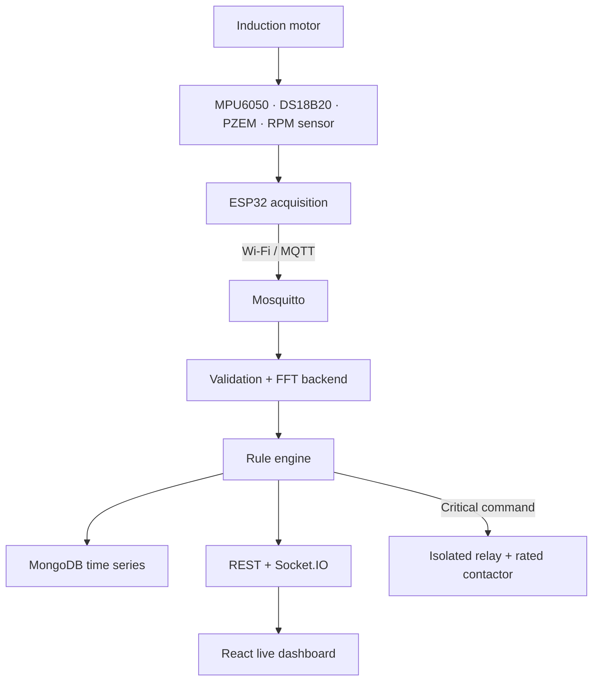

# IoT-Based Real-Time Induction Motor Condition Monitoring

[](https://github.com/MayankGangwar1234/motor_monitering/actions/workflows/ci.yml)

Complete Group 23 final-year ECE prototype for acquiring induction-motor temperature, vibration, voltage/current, and RPM with an ESP32; streaming readings through MQTT; performing backend RMS/FFT analysis; classifying health as **Normal / Warning / Abnormal / Critical**; storing history; and displaying live graphs and alerts on a React dashboard.

> **Electrical safety:** do not connect a hobby relay directly to an induction-motor mains circuit. Use an isolated driver and a correctly rated contactor under qualified laboratory supervision. This project is a monitoring/prototype protection layer, not a certified safety system; the physical emergency stop must remain independent.

## What is included

- Non-blocking ESP32/PlatformIO firmware with sensor diagnostics, NTP timestamps, Wi-Fi/MQTT reconnect, Last Will, RPM interrupt counting, 512 Hz vibration acquisition, OLED output, and opt-in local critical trip.
- MQTT + Node.js/Express backend with strict payload validation, live Socket.IO events, MongoDB time-series persistence, and bounded in-memory development fallback.
- Backend radix-2 FFT, Hann window, RMS/peak/std/crest factor, dominant frequency, and 1×/2× shaft-region features.
- Persistent, reason-coded four-state rule engine with immediate critical action, persistence, and recovery hysteresis.
- Responsive React/Chart.js dashboard with live cards, thermal/electrical trends, FFT spectrum, connection state, alerts, and protected stop/reset controls.
- Python NumPy/SciPy reference DSP with Welch PSD, a full software simulator, Docker Compose, CI, and automated synthetic-signal/rule/schema tests.

## System block diagram



See [docs/architecture.md](docs/architecture.md) for timing, DSP, calibration, and reliability details.

## Fully labelled ESP32 pin diagram


| ESP32 pin | Connected device | Direction / interface | Important wiring note |
|---|---|---|---|
| GPIO 21 | MPU6050 SDA + OLED SDA | I²C data | Both devices share the 3.3 V I²C bus |
| GPIO 22 | MPU6050 SCL + OLED SCL | I²C clock | Firmware uses 400 kHz |
| GPIO 4 | DS18B20 DATA | 1-Wire | Add 4.7 kΩ from DATA to 3.3 V |
| GPIO 16 | PZEM TX | UART2 RX | Cross TX → RX; use isolated PZEM TTL interface |
| GPIO 17 | PZEM RX | UART2 TX | Cross RX → TX |
| GPIO 27 | Hall/IR sensor OUT | Interrupt input | One pulse/rev default; never feed 5 V directly |
| GPIO 26 | Isolated relay IN | Active-low output | Relay drives rated contactor coil, not motor mains |
| GPIO 25 | Active buzzer | Output | Add a transistor driver if buzzer current is high |
| GPIO 2 | Onboard/status LED | Output | Solid when MQTT is connected |
| 3V3 / GND | MPU6050, OLED, DS18B20, compatible RPM sensor | Power | Use one low-voltage common ground |

## Run the complete application

Requirements: Docker Desktop/Engine with Compose, or Node.js 20+, MongoDB 7, and Mosquitto 2.

```bash
git clone https://github.com/MayankGangwar1234/motor_monitering.git
cd motor_monitering
docker compose up --build
```

Open:

- Dashboard: <http://localhost:8080>
- Backend health: <http://localhost:3000/health>
- API: <http://localhost:3000/api/motor/latest>

Preview every health state without hardware in a second terminal:

```bash
node backend/src/simulator.js
```

The simulator cycles through Normal, Warning, Abnormal, and Critical operating points every 25 seconds while generating a vibration waveform at the simulated shaft frequency. Stop it with `Ctrl+C`.

## Flash the ESP32

1. Install [PlatformIO](https://platformio.org/) in VS Code or with `pip install platformio`.
2. Copy `firmware/include/config.example.h` to `firmware/include/config.h`.
3. Enter Wi-Fi credentials and the computer/broker LAN address in `config.h`.
4. Confirm the pin table against your exact ESP32 board and sensor module.
5. Connect the ESP32 by USB and run:

```bash
pio run -d firmware
pio run -d firmware --target upload
pio device monitor -b 115200 -d firmware
```

For a no-sensor MQTT-path test, set `SIMULATE_SENSORS 1`. Leave `ENABLE_LOCAL_PROTECTION 0` until motor-specific thresholds are calibrated and the relay path has passed a dry-load test.

## Data topics and API

```text
motor/G23/telemetry
motor/G23/vibration/raw
motor/G23/vibration/features
motor/G23/status
motor/G23/alert
motor/G23/command
motor/G23/availability
```

Frequent telemetry and vibration use QoS 0. Availability, alerts, status, and commands use QoS 1. The complete payload schema and REST endpoint table are in [docs/mqtt-api.md](docs/mqtt-api.md).

## Verify the software

Backend FFT/rule/schema tests do not need external services:

```bash
node --test backend/test/*.test.js
```

Run the independent SciPy verification:

```bash
cd python-dsp
python -m unittest -v
```

Build the frontend and firmware:

```bash
cd frontend && npm install && npm run build
pio run -d ../firmware
```

CI repeats all four checks on every push. The FFT tests inject a known 50 Hz sine wave and assert the detected frequency, RMS, and amplitude; rule tests cover persistence, immediate critical transition, and recovery; schema tests cover accepted and rejected sensor payloads.

## Calibration and demonstration sequence

1. Record motor nameplate data and validate temperature, current, voltage, and RPM against reference instruments.
2. Fix the accelerometer position/orientation and collect several healthy baselines for each intended load.
3. Edit demonstration thresholds in `backend/src/config.js` using baseline statistics and supervisor-approved safety limits.
4. Replay software values for each condition; check reason codes, historical graphs, alerts, and recovery behavior.
5. Disconnect/reconnect Wi-Fi and Mosquitto; verify automatic recovery and offline display.
6. Dry-test relay logic with no motor mains. Only then connect an isolated driver to an appropriately rated contactor.
7. Complete a supervised 2–4 hour soak test and compare MQTT message/storage counts.

Do not deliberately damage, loosen, or unbalance a live motor. Demonstrate fault states with the simulator, recorded vibration playback, or a supervised purpose-built fault rig.

## Project layout

```text
firmware/       ESP32 PlatformIO firmware and pin configuration
backend/        MQTT ingestion, FFT, rules, persistence, REST/Socket.IO
frontend/       React and Chart.js operator dashboard
python-dsp/     Independent SciPy FFT/Welch reference and tests
mosquitto/      Local laboratory broker configuration
docs/           Architecture, schemas, API, and labelled pin diagram
.github/        Automated backend/frontend/Python/firmware verification
```

## Authors

- **Mayank Gangwar (20234102):** embedded hardware, ESP32, sensors, RPM, relay/protection, integration
- **Pragati Pandey (20234214):** MQTT, backend, MongoDB, dashboard, alerts
- **Suman Kumar (20234164):** signal processing, FFT/PSD, thresholds, rule-based condition assessment

Submitted to **Prof. Manish Tiwari**, Department of Electronics and Communication Engineering.

