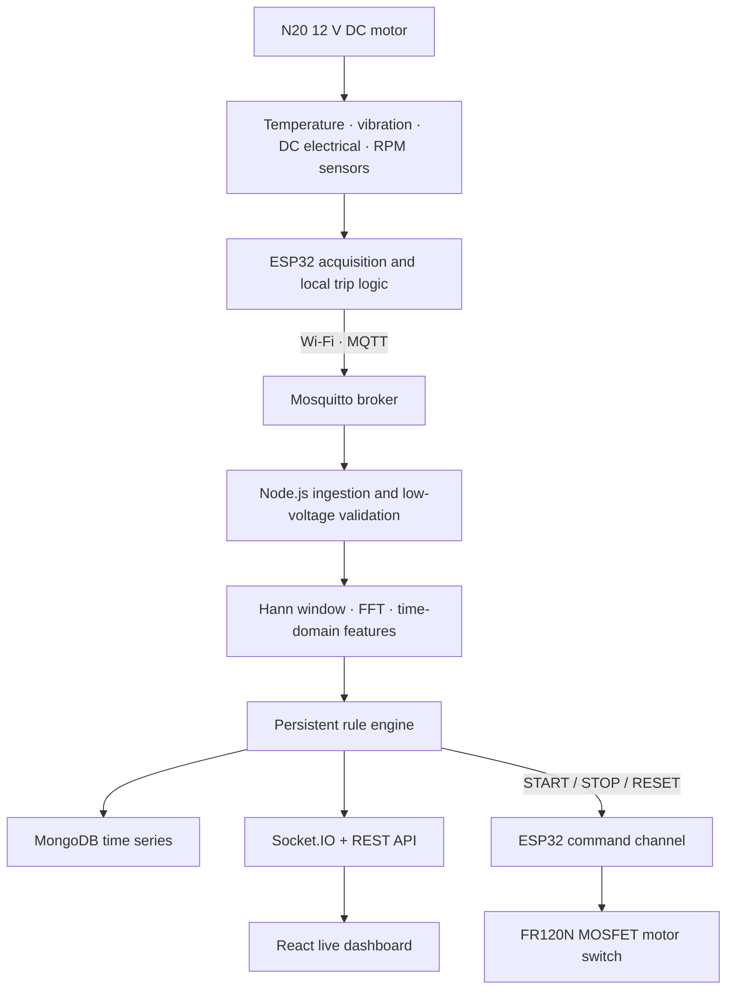

# Architecture and engineering decisions

## End-to-end data flow



The ESP32 publishes a 256-sample vibration block at 256 Hz once per second and slow telemetry every two seconds. A one-second block gives 1 Hz FFT-bin spacing, suitable for the approximately 5 Hz shaft frequency of the selected 300 RPM motor.

## Hardware domains

- **12 V motor branch:** adapter positive -> E-stop NC -> 2 A fuse -> INA219 VIN+ / VIN- -> motor/FR120N branch.
- **5 V electronics branch:** adapter -> LM2596 adjusted to 5.0 V -> ESP32 VIN/5V.
- **3.3 V logic:** ESP32 3V3 powers compatible sensor logic. GPIO inputs must not exceed 3.3 V.
- **Common ground:** motor-switch return, buck return, ESP32 and sensor grounds meet at a low-resistance common node.

The 1N5408 flyback diode is directly across the motor, striped end to motor positive. The hardware is used for ON/OFF control, not high-frequency speed control.

## Sampling and DSP

The ESP32 samples acceleration magnitude after gravity removal in a dedicated FreeRTOS task. The backend rejects non-finite or non-power-of-two blocks, removes their mean, computes RMS, standard deviation, peak, peak-to-peak and crest factor, applies a Hann window and performs a radix-2 FFT.

```text
frequency(k) = k x sample_rate / block_size
resolution   = sample_rate / block_size
shaft Hz     = RPM / 60
```

The backend reports the dominant non-DC peak and energy near the 1x and 2x shaft regions. `python-dsp/` provides an independent NumPy/SciPy reference and Welch PSD.

## Rule engine and motor state

The rule engine separately evaluates temperature, current, vibration RMS and RPM deviation. Warning and abnormal increases require persistence; critical conditions act immediately. Thresholds in `backend/src/config.js` are demonstration starting values for the selected N20 motor and must be tuned from healthy measurements.

Firmware maintains two independent state fields:

- `motorEnabled`: the GPIO23 command currently applied to the FR120N input.
- `tripLatched`: a protected stop occurred and RESET is required before another START.

On boot, GPIO23 is driven LOW before sensors or networking are initialized. START is rejected when a required sensor is missing, STOP is open, a threshold is unsafe or a trip remains latched. RESET clears a safe latch but leaves the motor OFF. The latching E-stop and fuse remain independent of firmware.

## Reliability boundaries

- Telemetry and raw vibration use MQTT QoS 0; status, commands, alerts and availability use QoS 1.
- Last Will marks the ESP32 offline after an abnormal disconnect.
- Malformed MQTT payloads are rejected without stopping the process.
- MongoDB stores 90 days of time-series data; development can use bounded memory fallback.
- Local protection is enabled for the demonstration model but limits must be calibrated after assembly.
- Physical START/STOP handling is compile-time optional; the motor cannot restart automatically after a trip or power recovery.
