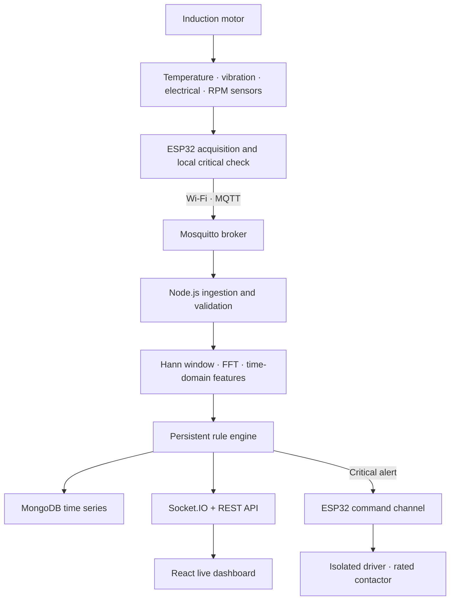

# Architecture and engineering decisions

## End-to-end data flow



The backend deliberately separates raw vibration blocks from slow telemetry. A 256-sample block at 512 Hz gives one spectrum every 0.5 seconds and an FFT-bin spacing of 2 Hz. Temperature, current, voltage and RPM are published every two seconds. This keeps MQTT overhead reasonable without losing vibration timing information.

## Sampling and DSP

The ESP32 samples the magnitude of acceleration after gravity removal in a dedicated FreeRTOS task. The backend rejects non-finite or non-power-of-two blocks, removes their mean, computes RMS, standard deviation, peak, peak-to-peak and crest factor, applies a Hann window, and performs a radix-2 FFT.

For FFT bin `k`, sample rate `fs`, and block size `N`:

```text
frequency(k) = k × fs / N
resolution   = fs / N
shaft Hz     = RPM / 60
```

The live backend reports the dominant non-DC peak plus energy around the 1× and 2× shaft regions. `python-dsp/` is an independent NumPy/SciPy reference implementation that also calculates a Welch PSD. Its synthetic-sine test prevents sensor behavior from being confused with FFT software correctness.

## Rule engine

Thresholds live in `backend/src/config.js`; they are demonstration defaults, not universal vibration limits. The engine evaluates temperature, current, vibration RMS, and RPM deviation separately, retains reason codes, and chooses the worst state. Warning and abnormal increases require three consecutive windows, recovery requires five healthy windows, and critical conditions act immediately.

Calibration procedure:

1. Record the motor nameplate, intended load, sensor position, and pulses per revolution.
2. Collect multiple healthy recordings without moving the accelerometer.
3. Calculate healthy medians, spread, and high percentiles by operating condition.
4. Agree motor-specific safety limits with the laboratory supervisor.
5. Replay predefined values for all four states before any relay test.
6. Test protection first with a dry/low-risk load, then only through a properly rated contactor.

## Reliability boundaries

- MQTT telemetry uses QoS 0; status, commands, alerts, and availability use QoS 1.
- ESP32 Last Will marks the device offline after an abnormal disconnect.
- Malformed MQTT payloads are logged and rejected without crashing the process.
- MongoDB uses a 90-day time-series collection. Development falls back to bounded in-memory storage unless `REQUIRE_MONGO=true`.
- Relay reset is rejected by the ESP32 while a local critical reading remains.
- Local trip thresholds are compiled but disabled until `ENABLE_LOCAL_PROTECTION=1` is deliberately set after calibration.

